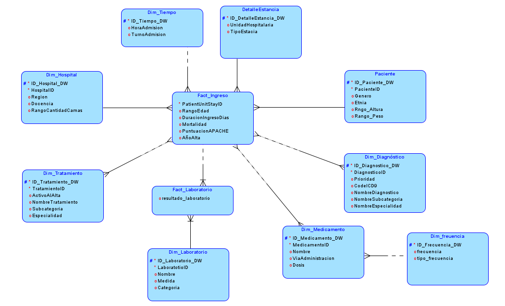
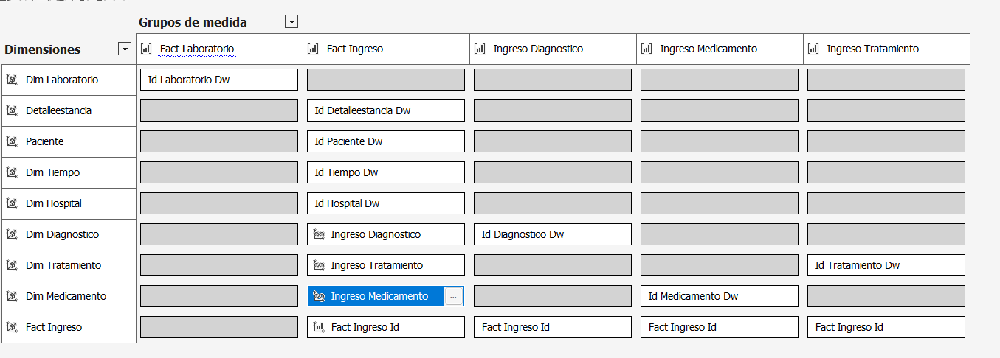
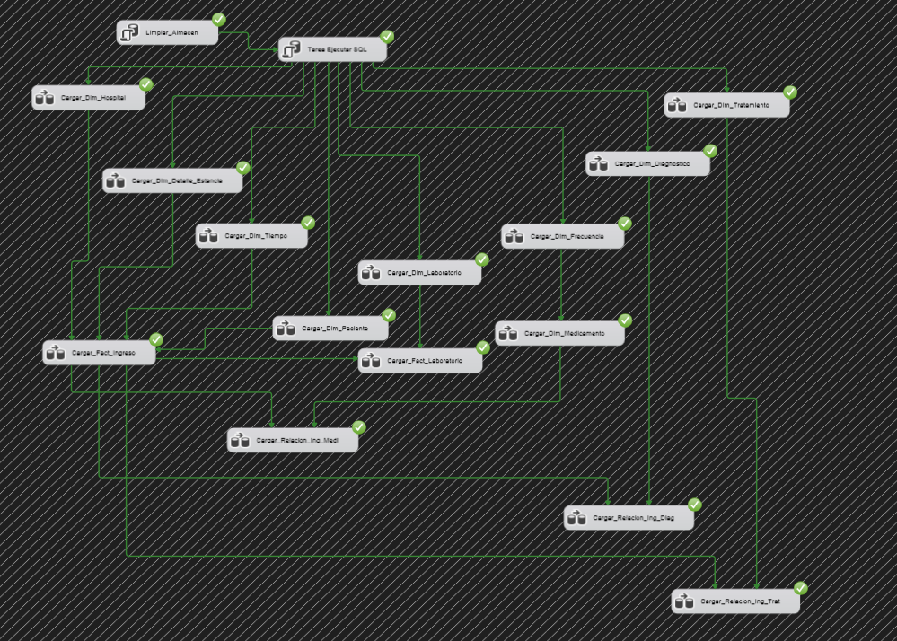

# Cardiovascular ICU Data Warehouse (eICU) — SQL Server · SSIS · SSAS · Power BI

End-to-end Business Intelligence solution that turns the raw, highly fragmented **eICU Collaborative Research Database** into a star-schema data warehouse, a multidimensional cube and a set of dashboards to analyse **mortality, length of stay and treatments of cardiovascular patients in intensive care units**.

> University project for *Data Warehouses and Business Intelligence* (Computer Engineering, University of Málaga, 2025/26). Built as a team of four.

## What it does

| Layer | Tool | What the team built |
|---|---|---|
| Source (OLTP) | SQL Server | eICU v2.0 (ICU stays from US hospitals, years 2014–2015) |
| ETL | SSIS | One package that wipes and reloads the whole warehouse: 9 dimension loads, 2 fact loads and 3 bridge-table loads |
| Warehouse | SQL Server | Star/snowflake schema: `FACT_INGRESO` (one row per ICU stay), `FACT_LABORATORIO`, 9 dimensions and 3 bridge tables |
| Cube | SSAS (Multidimensional) | Cube with calculated measures, many-to-many relationships and an XMLA script to refresh it |
| Analytics | MDX + Power BI | 14 MDX queries, each reproduced as a Power BI visual |

## Data scope

The source database used in the course is an extract of eICU with **2,520 ICU stays from 186 hospitals** and about 435k laboratory results. The cardiovascular filter selects **1,257 stays (184 hospitals) with about 249k laboratory results**.

## Key questions answered

- How do ICU admissions evolve across years, regions and teaching / non-teaching hospitals?
- Which cardiovascular diagnoses have the highest mortality, and how does it change by age range and **APACHE** severity score?
- Does mortality depend on the admission shift (morning / afternoon / night)?
- Which hospitals keep cardiovascular patients the longest, compared with the global average?
- Which medications are most used, and how do they differ between patients who died and those who survived?

## Design decisions worth highlighting

**Grain.** `FACT_INGRESO` has one row per ICU stay (`patientunitstayid`) with length of stay (converted from minutes to days in the ETL), APACHE score, age range, discharge year and survival.

**Many-to-many relationships.** A stay can have several diagnoses, treatments and medications at once. Putting them in the main fact table would duplicate rows and corrupt every aggregation, so we used **bridge tables** (`ingreso_diagnostico`, `ingreso_medicamento`, `ingreso_tratamiento`) with composite keys. In SSAS they are configured as *intermediate measure groups* in Dimension Usage so the cube resolves the relationship correctly.

**Separate fact table for lab results.** Lab results are generated at a much higher frequency and volume than admissions, so they live in `FACT_LABORATORIO` (different grain) instead of inflating `FACT_INGRESO`.

**Calculated measures in the cube, not columns in the warehouse.** APACHE average, mean stay, deaths, mortality % and mean lab result depend on the level of analysis chosen by the user, so storing them physically would be redundant and produce wrong results. SSAS computes them in context.

**Filtering the scope cleanly.** Instead of repeating a cardiovascular filter in every extraction, we created a stored procedure that builds a view (`vw_ingresos_cardiovasculares`) over `Diagnosis` and reused it as a common filter in the ETL of facts, patients, diagnoses, medications and treatments. A stay is kept in full once selected, so comorbidities can be analysed.

**Hierarchies only where they add value.** The source has no consistent admission date, so we did not invent artificial time hierarchies.

## Challenges and how they were solved

- **No admission year in the data** → discharge year used as the time reference; stay duration arrives in minutes and is converted in the ETL.
- **Hierarchical text fields** (`cardiovascular|...|...`) → denormalised into clean columns inside the dimensions, which moved complexity into the ETL but made analytical queries faster.
- **Missing age, weight and hospital region** → handled in the ETL and filtered in the MDX queries.
- **Dimensions not generated automatically in SSAS** → created manually from the Dimensions tab with explicit keys and attributes.
- **Cube results including non-cardiovascular diagnoses** (kept on purpose for comorbidity analysis) → explicit filters in the MDX queries where the question was cardiovascular-only.

## How to run it

1. Obtain the **eICU Collaborative Research Database** from PhysioNet (credentialed access required — the data is **not included** in this repository) and restore it in SQL Server.
2. Run [`database/Genera_DataWarehouse.sql`](database/Genera_DataWarehouse.sql) to create the warehouse and the `borrar_almacen` procedure.
3. Run the SSIS package to load it.
4. Process the cube (dimensions first, then the cube) with the XMLA refresh script — surrogate keys are regenerated on each load.
5. Open the Power BI report and point it to the cube.

## My contribution

- **Conceptual and logical model:** designed the star schema around the ICU-stay fact table, the separate laboratory fact table and the bridge tables that resolve the many-to-many relationships (diagnoses, medications, treatments).
- **ETL in SSIS:** built the load of the dimensions, the two fact tables and the bridge tables, including the reusable cardiovascular filter (a view created by a stored procedure) shared by all extractions.
- **Team support:** reviewed and helped with the cube, the MDX queries and the Power BI report.

## What I would do differently

- **Automate the cube refresh.** Surrogate keys are regenerated on every ETL run, so dimensions and cube must be reprocessed each time. I would chain the XMLA processing right after the load instead of running it by hand.
- **Decide the analytical scope earlier.** Keeping every diagnosis of a cardiovascular stay was right for comorbidity analysis, but it forced extra filters in several MDX queries. Next time I would flag the primary condition in the model from the start.
- **Test the pipeline end to end sooner**, with small automated checks (row counts, orphan keys) after each load.

## Team

Mayra Colodrero Torres · Esther Leyton Escobar · Celia Villena Rojas · Morena Sol Cruz

## Tech stack

`SQL Server` · `T-SQL` · `SSIS` · `SSAS (Multidimensional)` · `MDX` · `XMLA` · `Power BI` · `Data modelling (star schema, bridge tables)`

## Data and licence note

The eICU database is distributed by PhysioNet under a data use agreement and must not be redistributed. Only the schema, code and aggregated screenshots are shown here.
